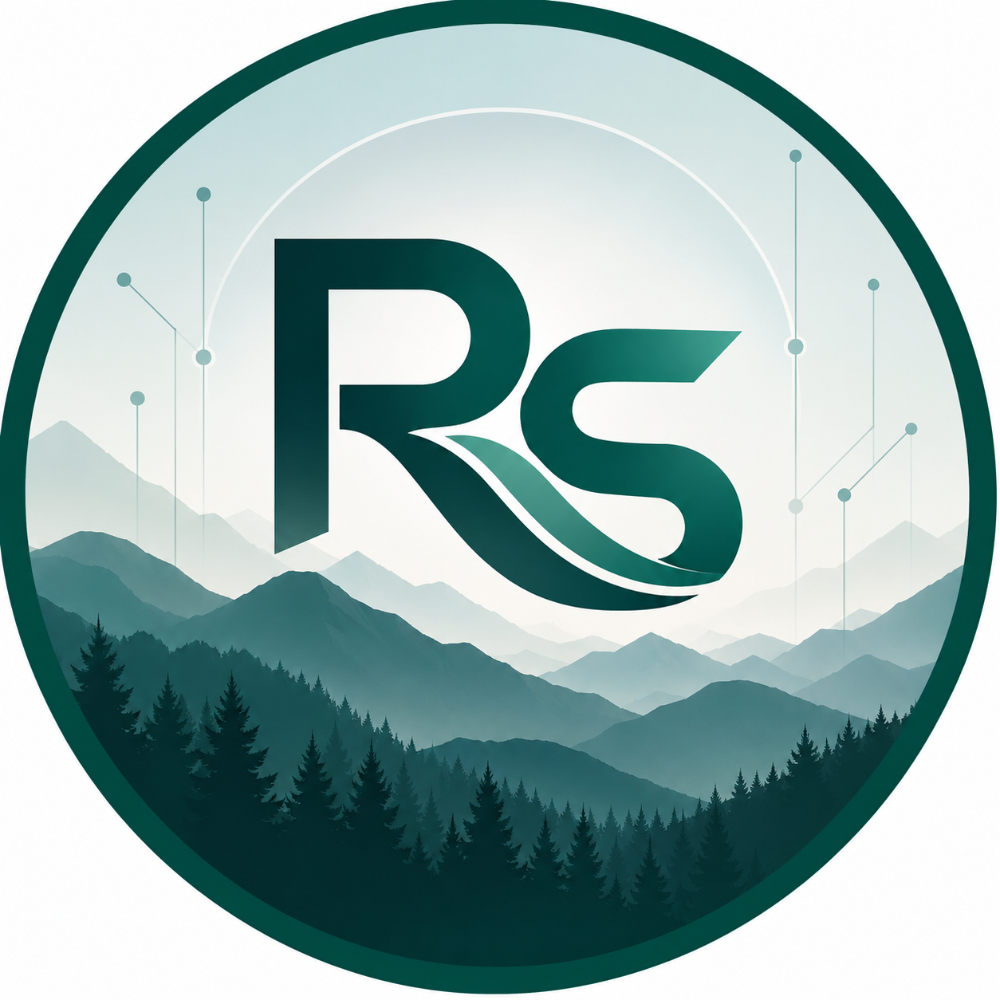

# Ross Swartz

### Software Engineering Leader · Software Consultant · Security Specialist

**Building reliable software. Solving complex problems.**

---

## About Me

I'm **Ross Swartz**, a software engineering professional with experience in engineering leadership, technical consulting, software development, and security-focused work.

My background spans leading engineering teams and initiatives, consulting on technical challenges, and developing software in security-conscious environments.

## Professional Experience

**Lead Software Engineer** · Lyntris  
June 2024 – September 2026

**Senior Software Consultant** · Splunk  
March 2020 – May 2024

**Software Developer | Security Specialist** · Concurrent Technologies Corporation  
May 2014 – February 2020

## Education

**Colorado State University Global**  
Bachelor's Degree in Information Technology · 2012–2014

## Areas of Focus

- Software engineering and maintainable systems
- Engineering leadership and technical collaboration
- Software consulting and problem-solving
- Security-conscious software development

## Connect

- **Email:** scotrose822@gmail.com
- **Phone:** (979) 921-8102

---

*Engineering with purpose. Building with precision.*

